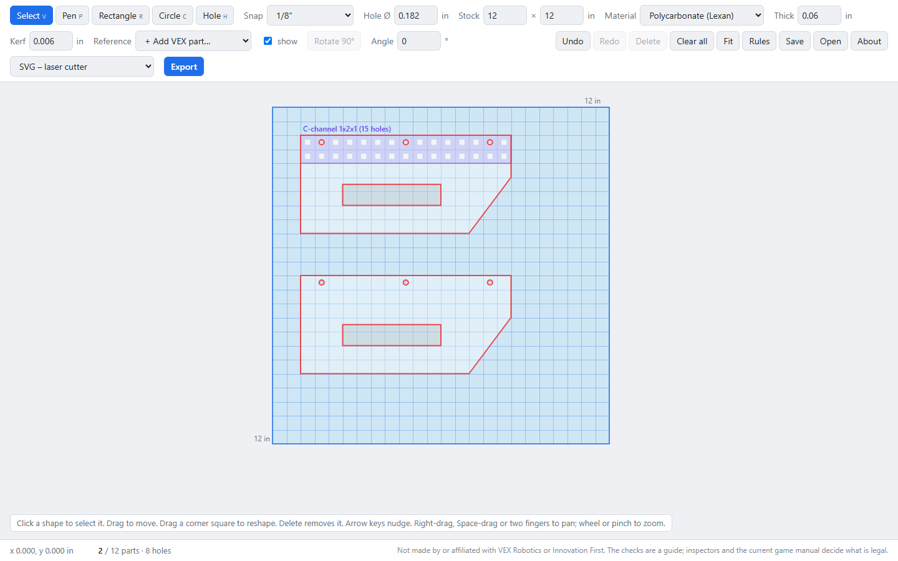
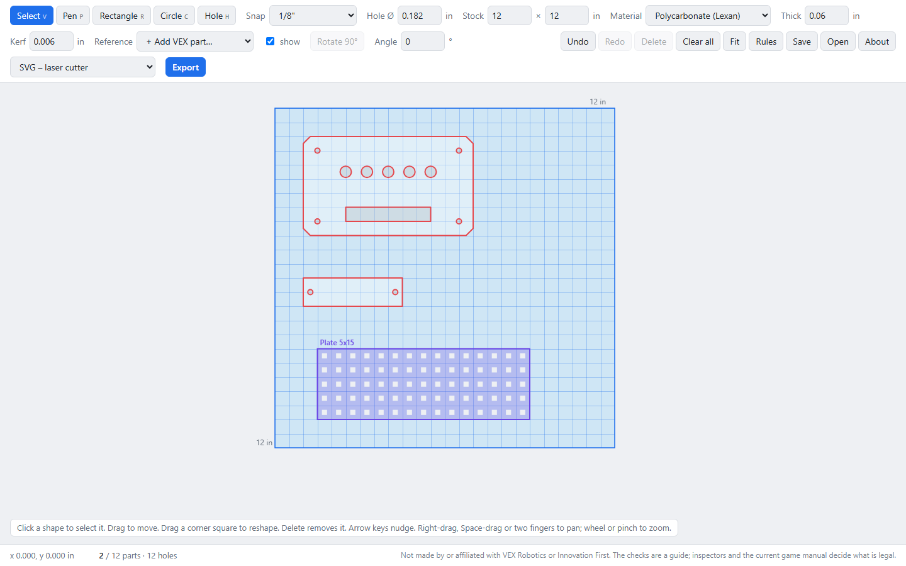
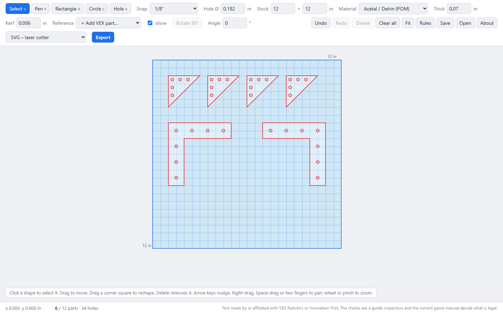

# JDCutter

*by Jaswanth Dorairaj*

**JDCutter is a free, browser-based tool for designing laser-cut polycarbonate (Lexan) and other plastic parts for VEX V5 robots.** Draw the part, line it up with VEX C-channel and plate hole patterns, check it against the VEX plastic rule, and export SVG or DXF for your laser cutter, or a true-size PDF template to cut by hand. No Fusion 360, Onshape or CAD experience needed, and it works on school Chromebooks.

**Open JDCutter:** https://jasuthmaker.github.io/plastic-cutter/app/
**Landing page, examples and FAQ:** https://jasuthmaker.github.io/plastic-cutter/

## Who it's for

- **VEX V5 Robotics Competition (V5RC / VRC) teams** making polycarbonate guards, covers, flaps, gussets and brackets, built for the 2026–27 game, Override.
- **VEX U teams, coaches and mentors** who want a quick 2D plastic layout tool without a full CAD course. (VEX U has its own plastic rules, so change the limits under Rules.)
- **Teams with a laser cutter** (LightBurn, Glowforge, xTool, Epilog, RDWorks) **and teams without one**: print a tiled template on Letter or A4 paper and cut with a saw or knife.

## Features

- **Drawing tools:** pen (polygons and open lines), rectangle, circle and hole. Grid snapping at 1/16", 1/8", 1/4" or 1/2" (the VEX hole pitch), Shift for 45° lines, and live dimensions in inches.
- **VEX metal overlay:** lay a see-through C-channel (1x2x1, 1x3x1, 1x5x1), bar, angle, plate or custom hole grid over your sheet. Holes snap to its 0.182" square-hole centres on the 0.5" pitch, so bolts line up with real VEX structure.
- **Plastic rule checks** (R24 in the V5RC Override manual):
  - piece size, measured at each part's best angle
  - piece count per robot
  - sheet thickness (0.070" max)
  - legal materials: polycarbonate, Delrin/acetal (POM), ABS, PET, HDPE, LDPE, nylon, polypropylene, PTFE, FEP and PEEK; acrylic is flagged because it shatters
  - thin plastic walls next to holes, where polycarbonate tends to crack

  The limits can be edited under **Rules** when the game manual changes.
- **Laser-ready exports:**
  - **SVG** in real inches with a red hairline cut stroke
  - **DXF** (R12) in inches or millimetres, so LightBurn doesn't import it at the wrong scale
  - **Kerf compensation:** part outlines move out and holes move in by half the beam width, so parts come out at the drawn size
- **Printable templates:** a PNG at 300 dpi (with DPI metadata) or a vector PDF at actual size, either one page or tiled on Letter/A4 with a 1" scale bar to check print scale.
- **Projects:** autosaves in your browser; Save/Open `.json` project files to share with your team; undo/redo up to 200 steps.
- **Runs anywhere:** a single HTML page with no install, no account and no server. Once the page is open it needs no internet, and it works on Windows, Mac, Linux, Chromebooks, tablets and phones (pinch to zoom).

## Example projects

Each one opens straight in JDCutter, ready to edit:

| Example | What it is | Open |
| --- | --- | --- |
| Intake guard | Two mirrored polycarbonate flaps bolted to a C-channel, with lightening slots | [Open](https://jasuthmaker.github.io/plastic-cutter/app/?example=intake-guard) |
| Brain cover | V5 Brain cover with vents and a wire slot, plus a battery strap | [Open](https://jasuthmaker.github.io/plastic-cutter/app/?example=brain-cover) |
| Gusset set | Four triangle gussets and two L brackets in Delrin, all holes on the VEX pitch | [Open](https://jasuthmaker.github.io/plastic-cutter/app/?example=gusset-set) |

## How to use it

1. Set your **stock size**, **material** and **thickness**.
2. Optionally add a **Reference** VEX part and drag it where the plastic will mount.
3. Draw the outline with **Rectangle** or **Pen**, then add mounting holes with **Hole** (0.182" by default). Holes snap to the reference part's holes.
4. Fix anything the footer warns about.
5. Set **Kerf** for your laser (0.004–0.008" is typical; cut a test square to measure it), choose a format and **Export**.

### Keyboard shortcuts

| Key | Action |
| --- | --- |
| V / P / R / C / H | Select, Pen, Rectangle, Circle, Hole |
| Shift (while drawing) | Straight and 45° lines |
| Enter / double-click | Finish an open line |
| Backspace (while drawing) | Remove the last point |
| Delete | Delete the selected shape or reference |
| Arrow keys | Nudge by one snap step |
| T | Rotate the selected reference 90° (drag its dot to rotate; hold Alt for free rotation) |
| Ctrl+Z / Ctrl+Y | Undo / redo |
| Ctrl+S | Save project file |
| Space-drag, right-drag or two fingers | Pan |
| Mouse wheel or pinch | Zoom |
| Esc | Cancel / deselect |

## FAQ

**Is JDCutter free?** Yes: no account, no ads, no trial.

**Is my drawing uploaded anywhere?** No. Everything runs in your browser and saves to your own computer.

**Will my part pass VEX inspection?** The checks catch common problems, but inspectors and the current game manual decide what's legal. Always check the plastic rule in the latest manual.

**Can I use it as a Fusion 360 alternative for VEX plastic?** For flat 2D plastic parts, yes. It doesn't do 3D modelling, bends or full robot CAD.

**What about bent polycarbonate?** Draw the flat pattern and mark bend lines on the part by hand after cutting. Every line JDCutter exports is a cut line, and bend lines aren't supported yet.

## Feedback

Found a bug or want a feature (more VEX parts, bend lines, nesting)? [Open an issue](https://github.com/jasuthmaker/plastic-cutter/issues).

## Files

| Path | What it is |
| --- | --- |
| `index.html` | Landing page |
| `app/index.html` | The JDCutter app (a single file, no build step) |
| `app/examples/*.json` | Example projects; open one with `app/?example=name` |
| `img/` | Screenshots of the examples |

To run it locally, open `app/index.html` in a browser, or serve the folder with `python -m http.server`.

---

JDCutter is made by Jaswanth Dorairaj. It is not made by or affiliated with VEX Robotics or Innovation First; VEX and VEX V5 are their trademarks.

<!-- keywords: JDCutter, JD Cutter, VEX polycarbonate template, VEX lexan DXF, VEX V5 plastic cutter, VRC polycarb, V5RC Override plastic rule R24, laser cut VEX parts, VEX CAD alternative, polycarbonate laser cutting robotics -->
